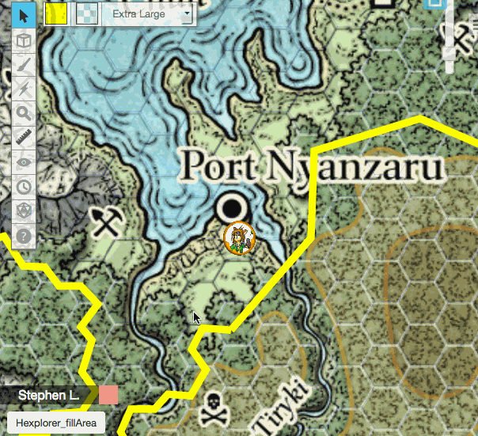

# Hexploration

A Roll20 Mod that covers a hex map with opaque hexes and uncovers them as the party explores.

Draw a shape over the area to hide, fill it with hexes, and every hex a player token moves through (and, if you like, the hexes around it) is revealed. Hidden locations can be tucked under hexes and are announced when they are found.

**Version 2.0.0 is a full rewrite that works in Jumpgate and Legacy games.** It no longer needs PathMath, MatrixMath, Vector Math or HTML Builder, and existing version 1 hex maps and commands keep working.



## Installation

1. Install **Hexploration** from the Roll20 One-Click library, or upload `Hexploration.js` to the game's API Scripts.
2. Save. On startup the Mod creates two handouts in the Journal:
   - **Hexploration - Help**: full instructions.
   - **Hexploration - Command Deck**: one-click buttons for every action.

If you are upgrading from version 1, you can remove PathMath, MatrixMath, Vector Math and HTML Builder unless another Mod uses them.

## Quick Start

1. Open a page whose grid is **Hex (V)** or **Hex (H)**.
2. Draw one or more shapes (polygon, rectangle, ellipse or freehand) around the area to hide.
3. Select the shapes and click **Fill** in the Command Deck, or type `!hexploration fill`.
4. Optionally, select tokens for important places and click **Mark Location** before filling. They are hidden under the hexes and announced when discovered.
5. Move a player token. The hexes it passes through, and those within its sight distance, are revealed.

Type `!hexploration` for the chat menu or `!hexploration help` for the command list.

## Commands

Only GMs can use these commands.

| Command                                       | What it does                                                                        |
| --------------------------------------------- | ----------------------------------------------------------------------------------- |
| `!hexploration`                               | Show the menu.                                                                      |
| `!hexploration fill`                          | Cover the selected shapes with hexes.                                               |
| `!hexploration fill inverse`                  | Cover the whole page except inside the selected shapes.                             |
| `!hexploration undo`                          | Undo the last fill, inverse fill or conceal, and restore the shapes it used.        |
| `!hexploration reveal`                        | Reveal the selected hexes, and the hexes under the selected shapes and tokens.      |
| `!hexploration reveal page`                   | Reveal every hex on the page without announcements.                                 |
| `!hexploration conceal`                       | Cover the area under the selected shapes and tokens with hexes again.               |
| `!hexploration explore`                       | Reveal around the selected tokens as if they had just moved there.                  |
| `!hexploration reset page`                    | Remove every hex on the page (asks first).                                          |
| `!hexploration name <text>`                   | Name the selected hexes, or the hexes under the selected tokens. Empty clears it.   |
| `!hexploration mark` / `unmark`               | Turn the selected tokens into hidden locations, or back.                            |
| `!hexploration set [<setting> <value>]`       | Change a setting, or show all settings.                                             |
| `!hexploration page set <setting> <value>`    | Override a reveal setting on the current page only.                                 |
| `!hexploration page clear`                    | Remove the current page's overrides.                                                |
| `!hexploration rescan`                        | Rebuild the page's hex list, for example after copying a page or game.              |
| `!hexploration calibrate` / `calibrate reset` | Line the hex grid up with tokens snapped to hex centres, or remove the calibration. |
| `!hexploration status`                        | Show what the Mod knows about the current page.                                     |
| `!hexploration journal rebuild`               | Rebuild the Help and Command Deck handouts.                                         |
| `!hexploration help`                          | List the commands.                                                                  |

### Version 1 commands

The version 1 commands still work, including the `Hexploration_menu` macro:

| Version 1                                 | Version 2                    |
| ----------------------------------------- | ---------------------------- |
| `!hexploration_showMenuMain`              | `!hexploration`              |
| `!hexploration_fillPoly`                  | `!hexploration fill`         |
| `!hexploration_fillInversePoly`           | `!hexploration fill inverse` |
| `!hexploration_hexModifyProperty name&&…` | `!hexploration name …`       |
| `!hexploration_configModifyProperty …`    | `!hexploration set …`        |

## How Revealing Works

- Only tokens on the token layer reveal hexes. **Tokens That Reveal** chooses which: tokens controlled by a player (the default, so the GM can move monsters freely), tokens that represent any character (the version 1 behaviour), or all tokens.
- A token reveals every hex it covers, so large tokens reveal several. With **Reveal Along Path** on, it also reveals every hex on the route it was dragged along, waypoints included.
- **Sight Distance** reveals the hexes around each of those hexes. With **Line of Sight** on, a hex is only revealed if no covered hex lies in between.
- **Hex Reveal Distance** is stored on hexes as they are drawn: those hexes can only be revealed from within that many hexes. Use it for terrain that hides what lies behind it.
- **Reveal Mode: Glimpse** turns hexes within sight see-through instead of removing them; they are removed when a token enters them.
- Roll20 draws token names, bars and auras above hexes. With **Hide Covered Tokens** on (the default), tokens under a covered hex have their player-visible name, bars and auras switched off until they are uncovered, so hidden monsters do not give themselves away.
- The Roll20 API does not report token moves made by other Mods. Moves made by TokenMod are picked up automatically. For other Mods, select the tokens and use `!hexploration explore`, or call the API below.

## Settings

| Key                 | Setting              | Default              | Per page | Description                                                                    |
| ------------------- | -------------------- | -------------------- | -------- | ------------------------------------------------------------------------------ |
| `hexLayer`          | Hex Layer            | `auto`               |          | `auto`, `foreground` or `objects`. Auto tries the foreground layer first.      |
| `fillColor`         | Fill Colour          | `#222222`            |          | Colour of new hexes. `rgba()` makes see-through hexes.                         |
| `strokeColor`       | Border Colour        | `#444444`            |          | Outline colour of new hexes.                                                   |
| `labelColor`        | Label Colour         | `#FFFFFF`            |          | Colour of GM-only name labels.                                                 |
| `glimpseColor`      | Glimpse Colour       | `rgba(34,34,34,0.5)` |          | Colour of glimpsed hexes.                                                      |
| `strokeWidth`       | Border Width         | `1`                  |          | Outline width in pixels (0–20).                                                |
| `maxDistance`       | Hex Reveal Distance  | none                 |          | Stored on new hexes; they reveal only from within this many hexes.             |
| `revealDistance`    | Sight Distance       | `1`                  | ✓        | Hexes revealed around a moving token (0–20).                                   |
| `lineOfSight`       | Line of Sight        | `on`                 | ✓        | Covered hexes block sight.                                                     |
| `revealPath`        | Reveal Along Path    | `on`                 | ✓        | Reveal the whole route a token is dragged along.                               |
| `revealBy`          | Tokens That Reveal   | `players`            | ✓        | `players`, `characters` or `all`.                                              |
| `revealMode`        | Reveal Mode          | `clear`              | ✓        | `clear` or `glimpse`.                                                          |
| `announce`          | Announce Discoveries | `all`                | ✓        | `all`, `gm` or `off`.                                                          |
| `pingDiscoveries`   | Ping Discoveries     | `off`                | ✓        | Ping players to discovered locations.                                          |
| `hideCoveredTokens` | Hide Covered Tokens  | `on`                 |          | Switch off player-visible names, bars and auras of tokens under covered hexes. |
| `language`          | Language             | `en-US`              |          | One of 24 languages. `!hexploration set language` lists them.                  |

**Hex Layer**, **Tokens That Reveal** and **Language** can also be set on the Mod's settings page in the API Scripts screen.

Games upgraded from version 1 keep their colours, border width and sight distance.

## Jumpgate and Legacy

- Hexploration detects the engine and draws `pathv2` shapes in Jumpgate and `path` shapes in Legacy games. Shapes drawn in either editor can be filled.
- With **Hex Layer** on `auto`, hexes go on the foreground layer, above tokens. If the game rejects that layer, the token layer is used instead and the GM is told.
- Jumpgate draws regular hexes, which differ slightly from Legacy's. If hexes do not line up with a page's grid, snap a token to a hex centre, select it and run `!hexploration calibrate`. Select two tokens in neighbouring hexes of the same row (Hex V) or column (Hex H) to correct the hex size as well.
- Copying a page or game gives its hexes new IDs. Run `!hexploration rescan` on the page to pick them up again, together with their name labels and location tokens.

## API for Other Mods

```js
// Reveal around a token as if it had just moved there.
// Pass its previous position to reveal along the route as well.
Hexploration.revealAround(token, { left: oldLeft, top: oldTop });
Hexploration.revealAround(tokenId);
Hexploration.version; // "2.0.0"
```

## Credits

Original Mod by [Ada Lindberg](https://app.roll20.net/users/46544/ada-l). Ada's art packs are on the [Roll20 Marketplace](https://marketplace.roll20.net/browse/publisher/165/ada-lindberg).

Version 2 maintained by [MidNiteShadow7](https://app.roll20.net/users/16506286/midniteshadow7) ([GitHub](https://github.com/steverobertsuk)).

If you find a bug or have an idea, post in the Roll20 Mod forum or open an issue on GitHub, and include any messages from the API console log.

## License

This script is licensed under the MIT License.
