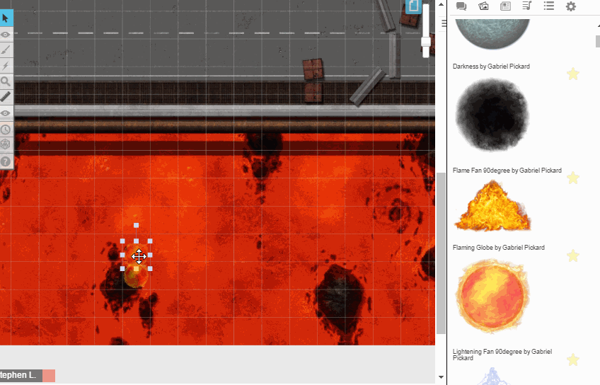

# PageFX

A Roll20 Mod that fills an area of the map with effects that keep going: rain, snow, embers, steam, fireflies and more. A token marks each effect's place, and its Aura 1 is the area. Effects run on **every page that has players on it**, including pages a split party has been sent to, and stop when the players leave. Everything is set from chat menus, and triggers can start or stop effects as combat rounds pass or tokens move.

**Version 2.0.0 is a full rewrite of Ada Lindberg's PageFX 1.3** for Jumpgate. Your version 1 tokens keep working, and `!pageFX on` and `!pageFX off` still do what they did.



## Installation

1. Install **PageFX** from the Roll20 One-Click library, or upload `PageFX.js` to the game's Mod Scripts.
2. Save. PageFX creates two GM-only handouts in the Journal:
   - **PageFX - Help**: full instructions.
   - **PageFX - Command Deck**: buttons for the main actions.

## Quick Start

1. Put a token where the effect should be (the GM layer keeps it hidden from players) and select it.
2. Type `!pagefx presets`, or open the Command Deck and click **Presets**, then click a preset such as **Heavy rain**.
3. Resize the token's Aura 1 to set the area the effect fills. The aura is hidden from players.
4. Move players to the page. The effect starts, and stops again when they leave.
5. Type `!pagefx` to open the menu, and click **Edit** on an effect to change it.

## Effects

- An effect is a token plus settings PageFX keeps. Move the token to move the effect, and change its Aura 1 to change the area. Deleting the token deletes the effect.
- Each effect has one or more **layers**. Each layer spawns one thing, again and again, with a random wait between its shortest and longest time.
- A layer can spawn a built-in Roll20 effect (type and colour, such as `burn-fire`), a custom FX saved in the game, or a custom FX definition pasted as JSON. Missing values in a definition are filled in, so a short definition still draws.
- Beam-like effects (beam, breath, splatter, and custom FX with angle -1) are drawn between two points. Their direction is random, or a fixed number of cells across and down.
- **Intensity** multiplies how often an effect spawns. The intensity setting multiplies every effect.
- **Off** stops an effect until it is turned on. **Pause** holds it until it is resumed. **Pause all** holds every effect without changing them.
- Jumpgate draws custom FX definitions in white unless they are saved as custom FX, so PageFX saves its own as custom FX named "PageFX: …". They are removed when no effect uses them. Leave them in place.

## Which Pages Run

- Effects run on the page with the player ribbon and on every page a player has been moved to on their own (split party).
- Turn on **GM Page Preview** to also run effects on the page each GM is looking at, to try them out with no players there.
- Each page gets at most **Max Spawns Per Second** (30 by default). If effects ask for more, some spawns are skipped, and the GM is told once.
- When another Mod moves the ribbon or splits the party, Roll20 tells no one, so PageFX looks every few seconds and catches up.

## Presets

A preset gives an effect a set of ready-made layers. Changing a layer afterwards makes the effect your own. Other Mods can add presets with `PageFX.registerPreset`.

| Pack            | Presets (ID)                                                                                                                                                                         |
| --------------- | ------------------------------------------------------------------------------------------------------------------------------------------------------------------------------------ |
| Weather         | Light rain (`light-rain`), Heavy rain (`heavy-rain`), Thunderstorm (`thunderstorm`), Snow (`snow`), Blizzard (`blizzard`), Hail (`hail`), Sandstorm (`sandstorm`), Fog wisps (`fog`) |
| Fire and heat   | Embers (`embers`), Falling ash (`ash`), Bubbling magma (`magma`), Lava spurts (`lava-spurts`), Sparks (`sparks`)                                                                     |
| Water           | Cave drips (`drips`), Steam vents (`steam`), Geyser (`geyser`), Waterfall spray (`spray`), Bubbles (`bubbles`)                                                                       |
| Magic and eerie | Fireflies (`fireflies`), Arcane motes (`arcane-motes`), Necrotic mist (`necrotic-mist`), Holy glimmer (`holy-glimmer`), Swamp gas (`swamp-gas`)                                      |

## Triggers

A trigger starts, stops, switches or fires an effect when something happens. Add them from the effect's card, or with `!pagefx trigger add`.

- **Each round**: Roll20 keeps no round number, so a round begins when the turn order is advanced from its last entry back to the top. A custom turn order entry named "Round" is used instead when there is one. Choose every so many rounds, or one round. The first round of a combat does not count as a change.
- **On a turn**: when a chosen token reaches the top of the turn order. Select the token on the map before clicking the button.
- **Token enters** or **leaves**: when a token moves into or out of the effect's area, or the Aura 1 of another token you select. By default only tokens a player controls count; choose any token, or give names.
- **Fire a burst** spawns the effect several times at once. **First time only** makes a trigger go off once.
- Roll20 tells Mods nothing when another Mod moves a token. Mods that move tokens can call `PageFX.checkToken(token)` afterwards.

## No-Effect Areas

- A no-effect area is a token where no effect ever spawns, such as the inside of a house in a storm. Its area is the token and its Aura 1.
- Select the token and click **No-effect area** in the menu or Command Deck. Tokens named `NullFX`, as in version 1, are no-effect areas too.

## Commands

Only GMs can use these commands. They act on the selected tokens, or on the tokens given with `--ids id1,id2`. Layer commands act on layer 1 unless `--layer n` says otherwise. Other Mods can send them too; replies go to the GM.

| Command                                          | What it does                                                                                                                                                                                                       |
| ------------------------------------------------ | ------------------------------------------------------------------------------------------------------------------------------------------------------------------------------------------------------------------ |
| `!pagefx`                                        | Open the menu: the effects on your page, and buttons for everything else.                                                                                                                                          |
| `!pagefx create [name]`                          | Make the selected tokens effects. Their Aura 1 is the area; one is added if they have none.                                                                                                                        |
| `!pagefx edit`                                   | Show the card for each selected effect, with buttons to change it.                                                                                                                                                 |
| `!pagefx preset <id>`                            | Give the selected tokens a preset, making them effects first if needed.                                                                                                                                            |
| `!pagefx presets`                                | List the presets, by pack.                                                                                                                                                                                         |
| `!pagefx on \| off \| pause \| resume \| toggle` | Turn the selected effects on or off, or pause and resume them. With nothing selected, `on` and `resume` start everything again and `off` and `pause` hold everything (as `!pageFX on` and `off` did in version 1). |
| `!pagefx fire [count]`                           | Spawn the selected effects now, once or a few times, to try them out.                                                                                                                                              |
| `!pagefx fx <effect>`                            | Set what a layer spawns: a built-in effect such as `burn-fire`, the name of a saved custom FX, or a custom FX definition in JSON.                                                                                  |
| `!pagefx interval <shortest> [longest]`          | Set the time between spawns of a layer, in milliseconds. Each wait is picked between the two.                                                                                                                      |
| `!pagefx direction random \| <across> <down>`    | For beam-like effects, set where each spawn ends: random, or cells across and down from where it starts.                                                                                                           |
| `!pagefx area <radius> [circle\|square]`         | Set the area: the token's Aura 1 radius in page units, and its shape.                                                                                                                                              |
| `!pagefx intensity <n> \| intensity global <n>`  | Multiply how often the selected effects spawn (0.1 to 5). With `global`, change it for every effect.                                                                                                               |
| `!pagefx name <text>`                            | Rename the selected effects.                                                                                                                                                                                       |
| `!pagefx layer add [effect] \| layer remove <n>` | Add a layer, so one effect spawns several things, or remove one.                                                                                                                                                   |
| `!pagefx trigger add <event> <action> [options]` | Add a trigger: on `round`, `turn`, `enter` or `leave`, do `start`, `stop`, `toggle`, `fire` or `burst`. Options: `every=2`, `round=3`, `count=5`, `who=players\|all\|named`, `names=A;B`, `area=selected`, `once`. |
| `!pagefx trigger remove <n> \| trigger clear`    | Remove one trigger, or all of them, from the selected effects.                                                                                                                                                     |
| `!pagefx null create \| null remove`             | Make the selected tokens no-effect areas, where no effect ever spawns, or stop them being one.                                                                                                                     |
| `!pagefx delete`                                 | Take the effect off the selected tokens. The tokens stay on the map.                                                                                                                                               |
| `!pagefx status`                                 | List every effect, its page, and whether it is running.                                                                                                                                                            |
| `!pagefx settings`                               | Show the settings.                                                                                                                                                                                                 |
| `!pagefx set <setting> <value>`                  | Change a setting: `language`, `gmPagePreview`, `intensity` or `maxSpawnsPerSecond`.                                                                                                                                |
| `!pagefx rescan`                                 | Take over new tokens named PageFX or NullFX, and forget effects whose tokens were deleted.                                                                                                                         |
| `!pagefx journal rebuild`                        | Rebuild the Help and Command Deck handouts.                                                                                                                                                                        |
| `!pagefx help`                                   | Show the command list.                                                                                                                                                                                             |

## Settings

Change settings from the Settings card, or with `!pagefx set`. Language can also be set on the Mod's settings page.

| Setting              | What it does                                                         |
| -------------------- | -------------------------------------------------------------------- |
| `language`           | The language of PageFX's menus, messages and handouts.               |
| `gmPagePreview`      | Also run effects on the page each GM is looking at (off by default). |
| `intensity`          | Multiplies how often every effect spawns (1 by default).             |
| `maxSpawnsPerSecond` | The most spawns on one page each second, 1 to 60 (30 by default).    |

## For Other Mods

PageFX publishes a `PageFX` object. Where a function takes a token, the token's ID works too.

```js
PageFX.activateAllEffects(); // resume every effect (version 1)
PageFX.deactivateAllEffects(); // pause every effect (version 1)
PageFX.activateEffect(token); // also deactivateEffect and toggleEffect (version 1)
PageFX.start(token); // also stop, pause and resume
PageFX.setIntensity(token, 2);
PageFX.fire(token, 3); // spawn now
PageFX.create(token, { name, fx, interval, direction, intensity }); // PageFX.remove(token) takes it off
PageFX.getEffect(token); // also listEffects(pageId) and isRunning(token)
PageFX.registerPreset(id, definition); // for this session; listPresets() lists them
PageFX.checkToken(token); // after your Mod moves a token, for enter and leave triggers
```

## Upgrading From Version 1

- Tokens named `PageFX` and `NullFX` are taken over on the first start and keep working as before.
- Until you change an effect from chat, its token's GM Notes, Bar 1 (time between spawns) and Bar 2 (beam direction) still drive it, and the interdiction marker still turns it off. Once you change it from chat, the GM Notes and bars are yours again.
- Version 1 only ever drew effects on the player ribbon page, and spawned saved custom FX twice. Both are fixed.
- The version 1 commands still work: `!pageFX on` is `!pagefx resume`, and `!pageFX off` is `!pagefx pause`.

## Troubleshooting

- **An effect does not run**: open its card. The State line says why: off, paused, no effect chosen, cannot run (with the reason), or not on a live page (no players there; turn on GM Page Preview to try it).
- **You see nothing**: very small or short-lived particles are hard to see on a busy map. Try a preset, raise the intensity, or make the area smaller.
- **Effects look thin**: the page may be at Max Spawns Per Second. Lower some intensities, or raise the limit.
- **Effects stopped after copying a page or game**: run **Rescan**.
- For anything else, check the API console log and include its messages when asking for help.

## Languages

PageFX speaks 24 languages: Afrikaans, Catalan, Chinese (Traditional), Czech, Danish, Dutch, English, Finnish, French, German, Greek, Hebrew, Hungarian, Italian, Japanese, Korean, Polish, Portuguese (Portugal), Portuguese (Brazil), Russian, Spanish, Swedish, Turkish and Ukrainian. Choose one from the Settings card, with `!pagefx set language <code>`, or on the Mod's settings page.

## Credits

Original Mod by [Ada Lindberg](https://app.roll20.net/users/46544/ada-l) ([art packs on the Roll20 Marketplace](https://marketplace.roll20.net/browse/publisher/165/ada-lindberg)).
Version 2.0 rewritten and maintained by [MidNiteShadow7](https://app.roll20.net/users/16506286/midniteshadow7) ([GitHub](https://github.com/steverobertsuk)).

If you find a bug or have an idea, post in the Roll20 Mod forum or open an issue on GitHub, and include any messages from the API console log.
